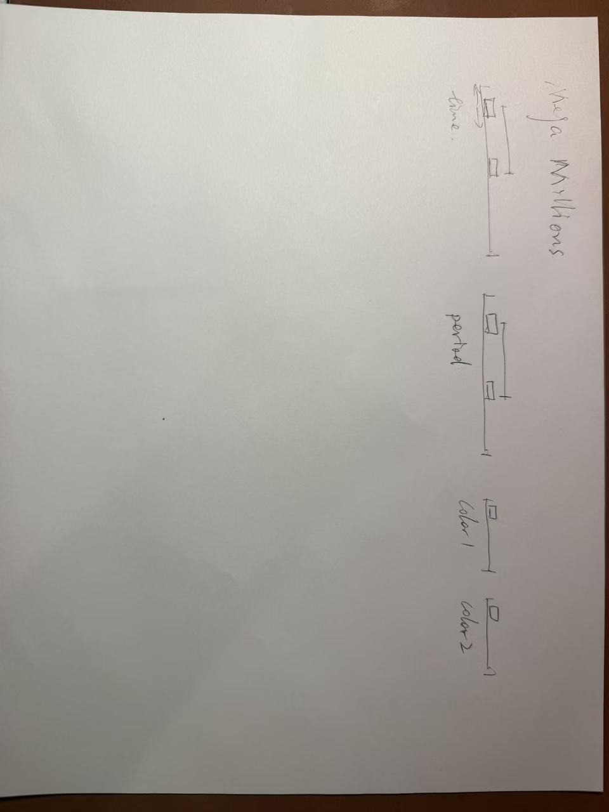
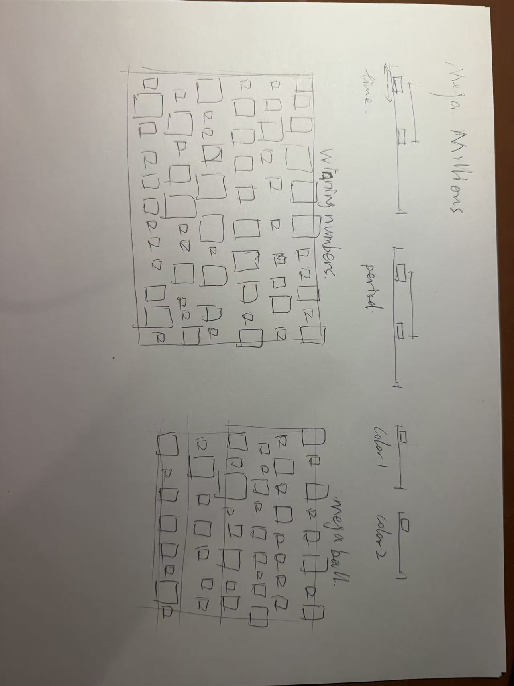
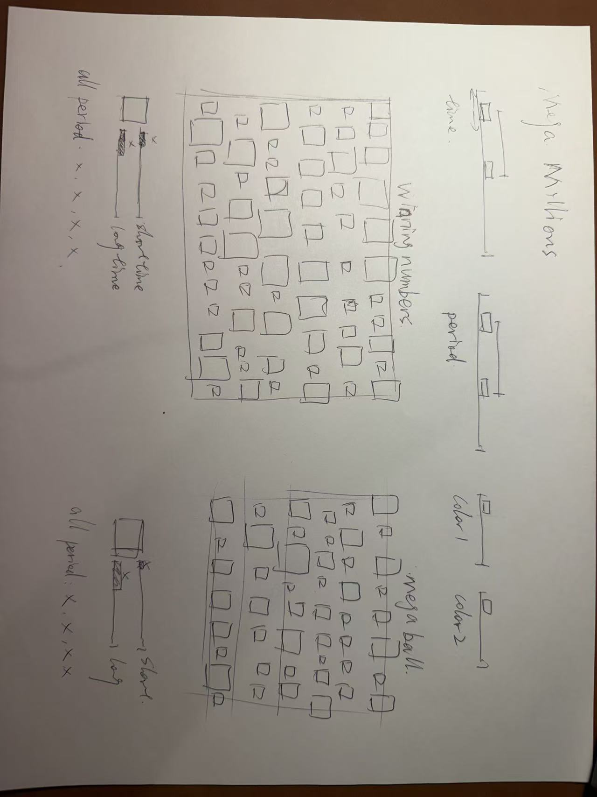

I plan to continue improving my Week11 lottery data visualization project. I currently use the results from the most recent 100 Mega Millions draws. I count how often each winning number and Mega Ball appears. The size of the squares, the size of the numbers, and the brightness show the differences in frequency. The squares for the latest draw also rotate, so viewers can easily find the latest winning numbers.

The current visualization only shows the frequency results for the most recent 100 draws. It does not show the numbers from individual draws, and I cannot adjust the time range. Although the visualization compares frequencies, it does not show the exact number of times each number appears. The rotation adds movement, but it only marks one draw. It cannot show how numbers appear and disappear over time. I could also collect several times more draws. This could help me explore whether these numbers show a 50% probability across the full drawing history. My guess is that if all numbers appear randomly, the sizes and brightness of the squares should become more uniform when I track data over a longer period. However, the data might also show larger differences that surprise me. Therefore, I want to ask: As the number of draws increases, do the proportions of appearances become closer? Do numbers that appear more often in the short term still stand out in the long term? How does a number’s recent appearance relate to its frequency over a longer period?

I plan to add buttons or sliders so I can choose how many draws to include. For example, they could compare the most recent 20 draws, 50 draws, or a larger range, such as 300 draws. I also want to compare short-term and long-term results to see whether the numbers show similar patterns. And I want to show the exact number of times each number appears. When I click a number, they will see its count, its proportion of appearances within the selected range, and the date when it last appeared. I could also highlight numbers that have never appeared within the selected range.

I will divide the page into three areas: the top, middle, and bottom. The top will be the control area. I can select a date range, choose the number of draws, and change the colors of the squares.

The middle will still show the square grids for the winning numbers and Mega Ball numbers. These grids will show how often each number appears.

The bottom will show detailed information about the selected number. This will include its short-term frequency, long-term frequency, and all the draws in which it appeared.

These improvements will involve adding an adjustable date range. and this is something I have not done before. I will also need to add selecting the number of draws within that date range. I think connecting these two controls will be a challenge.

I also want to add more animation, but I have not decided which effects would work best. I need to consider how the movement can match the information I want to show. For example, when I change the time range or the number of draws, the squares could smoothly change size or transition in other ways.

Previous work:

[Week11 data visualization](https://link-p.github.io/CC-ll6232/week11.data_visualization/index.html)