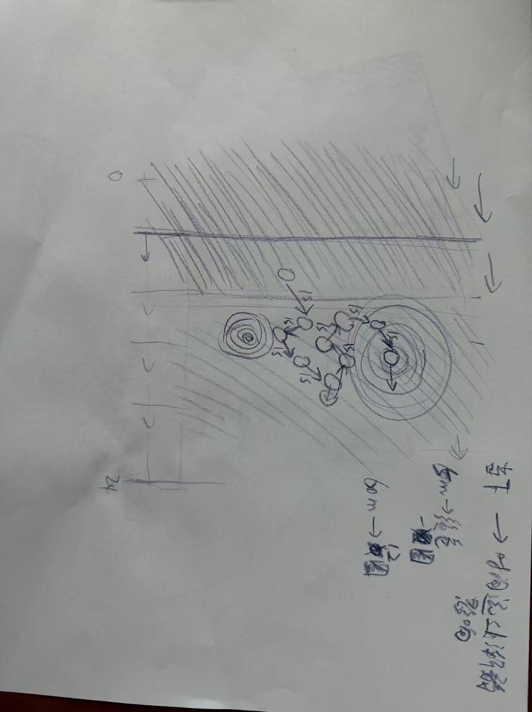
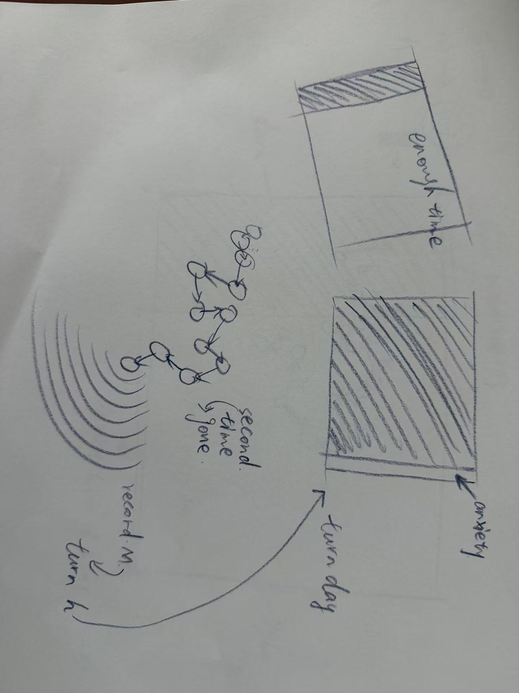
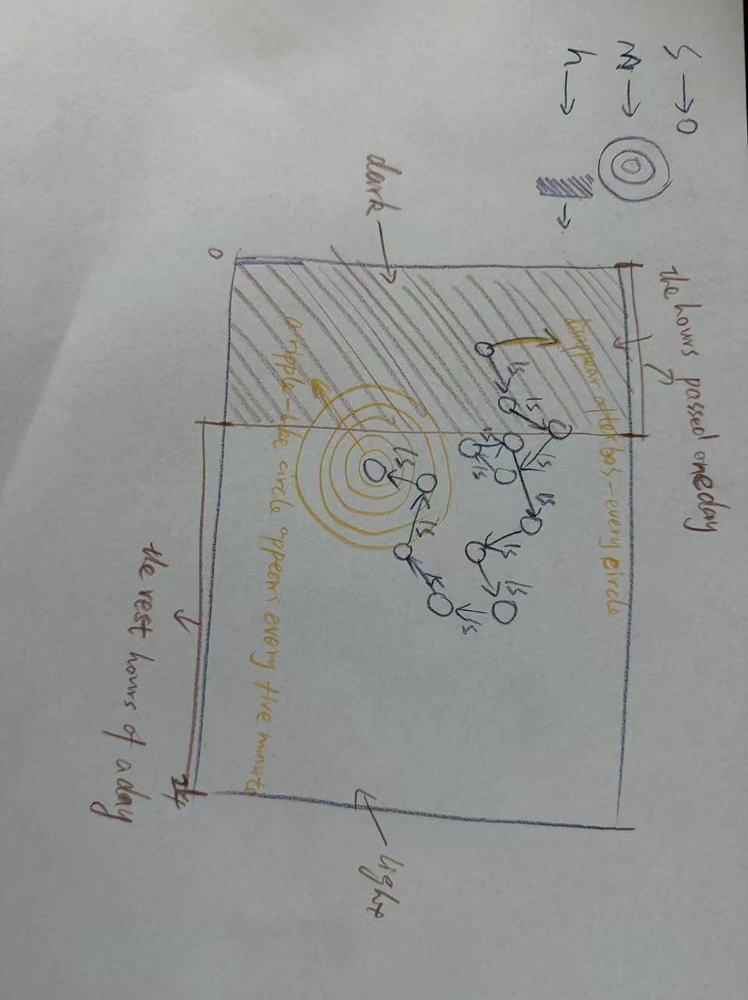
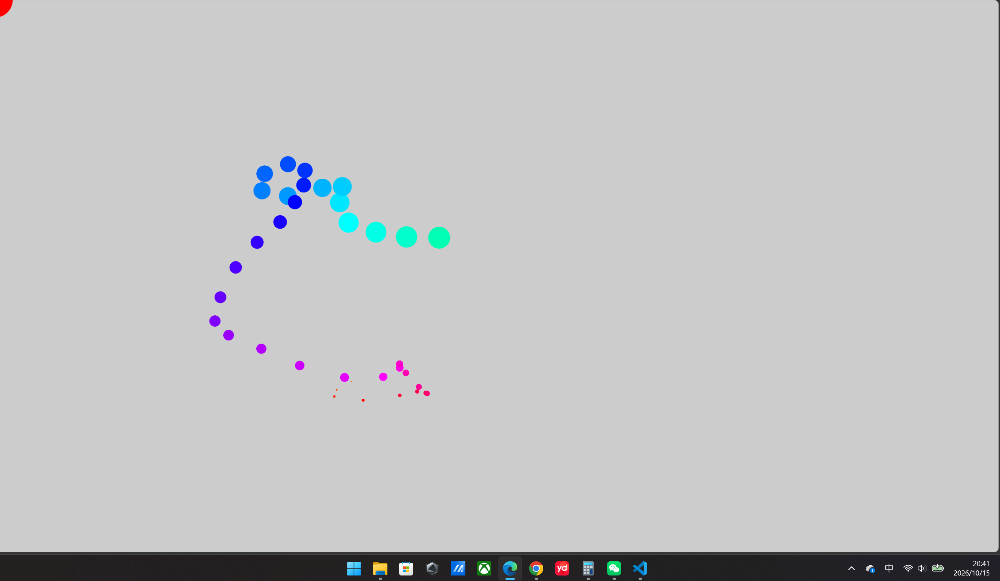
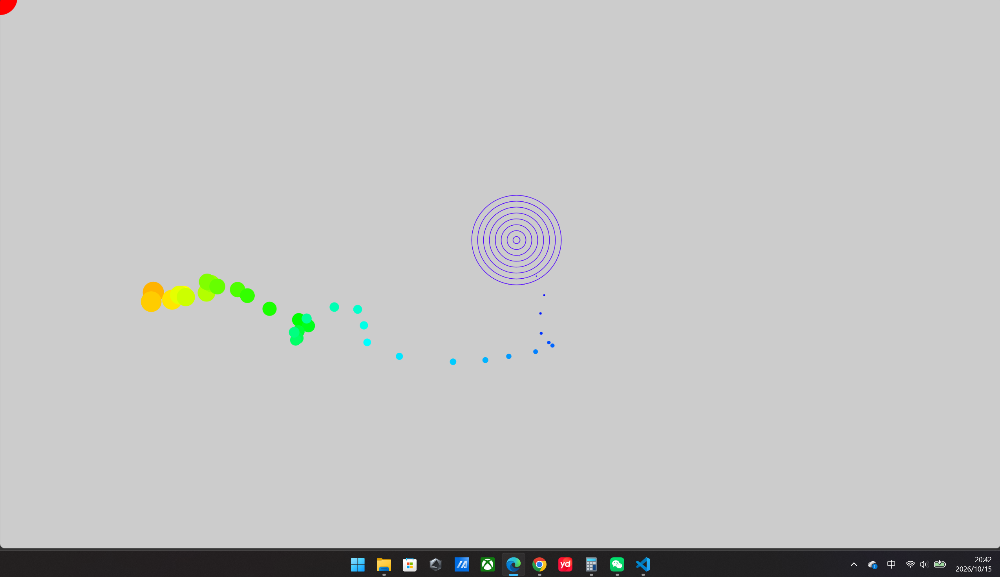
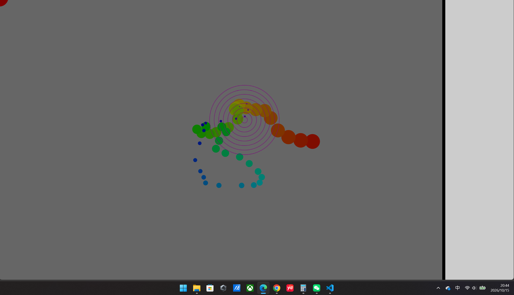

For this clock assignment, I used three units of time, second, minute and hour. I want to turn the time in a day into a visible space. And by showing how much time is left to express a feeling of anxiety about time. the record position example from week5 is basis for my idea for second. I used circles moving random to represent second. And I changed the positioin history value to 60 to match the 60 seconds in a minute. Then I used rings to represent minute. The rings are centered at the newest position in the second arrays. I added one ring every five minutes. This shows the current five-minute range, such as 0-5 or 5-10 minute. And I used hour to show how much of the day has passed and how much is left. I represented this with a line and two colors. The line moves from left to right. The area to the left is gray and represnet the time that has passed. The area to the right is white and represent the time left in the day. This makes it easy to see the space for the rest of a day getting smaller and smaller until it disapperas.

Then I started turning my ideas into code. I planned to use the same color for all the circles represent second. But this make it hard to tell how many second had passed in the minute. Only the size of the circles were different. So I used the second value to set the hue in HSB. The colors show roughly second in a minute. For example, red is around 0 second, and blue is around 40 second. The newest circle is also the smallest, which makes it easier to tell new circles. The size and color of the circles help show the second within a minute.

After that I strated working on the minutes. This part is not much difficult. I just need to calculate how many five-minute periods had passed. Then I used a loop to draw the rings. And the newest position in the second arrays is the center of the minute rings

Then I combined the current hour with the minute as a fraction of an hour. and I multiply this value by one twenty-fourth of the canvas width. This give me the x position of the hour line and the width of the rectangle. And finally I wanted to show that when we feel anxious about time, our emotion do not change as steadily as the second, because the emotion will change and fluctuate in that time. So I used millis to make the line width change twice per second, which can be compared with the second change on the canvas.
