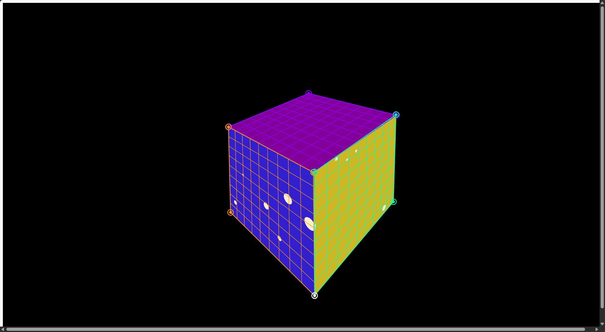
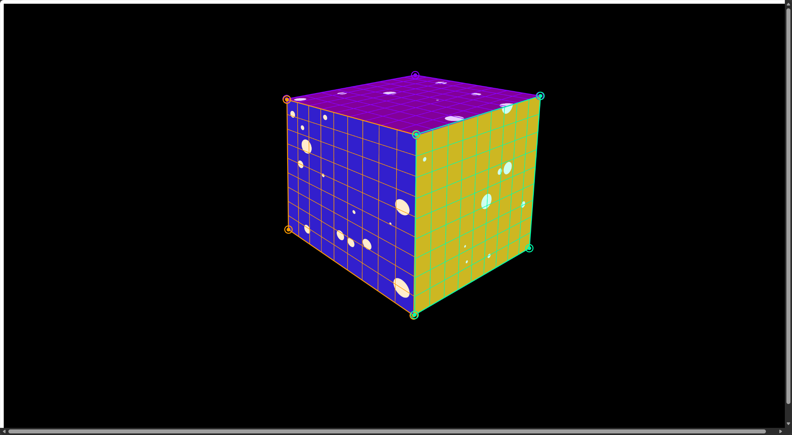
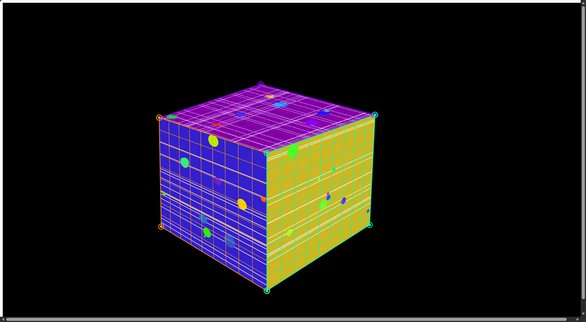
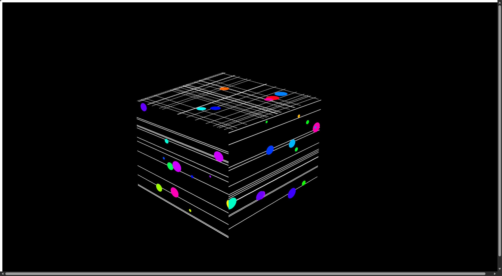

In last week’s class, I experimented with moving objects back and forth within a single surface. For this mapping assignment, I wanted to explore movement between different surfaces. I created three separate mapping surfaces for three groups of balls moving in different directions.

First, I made one ball move back and forth between the left and right surfaces to understand how to translate coordinates between them. I then added a group of balls of different sizes moving horizontally across these two surfaces.

Next, I added movement between the left and top surfaces, as well as between the right and top surfaces. This made the balls appear to travel continuously across the different faces.

I then added random color changes to the balls and introduced multiple lines moving at different speeds. The lines travel upward from the bottom of the left and right surfaces. When they reach the top surface, they form an intersecting grid.

For my first projection test, I placed the intersecting grid on the top surface. I then experimented with several different projection layouts.In addition to filling the entire square area, I explored treating the three surfaces as separate sections. I reduced the size of the mapped areas to leave gaps between them and observe how the objects appeared to move across those gaps.

### Video 1
### Video 2
### Video 3

I then rotated the arrangement so that the intersecting grid appeared on a front-facing side. I felt that this created a stronger visual effect.

### Video 4
### Video 5