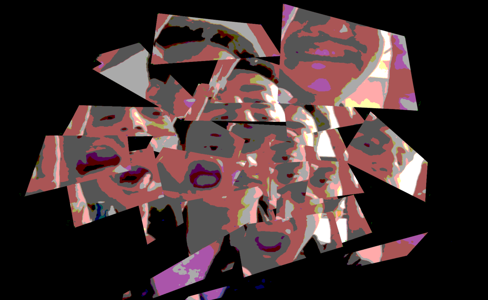
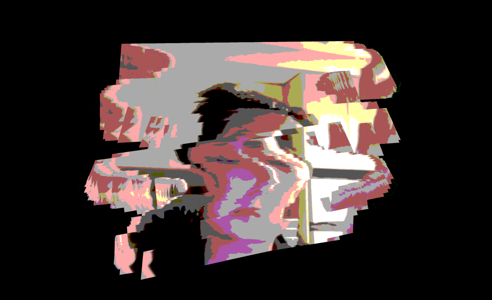

For this project, I used handpose to control the image. I wanted to use my hands to select part of the camera view and create a screenshot effect, which could become a tool for marking things like a collage self portrait, or by continuously capturing each frame to create a distorted self portrait. Truning the act of framing a camera shot into an hand interaction make me feel quite natural. So I read the coordinates of the thumbs and index fingers of both hands, then used these four fingertip points with Clip and a Shape to reveal part of the camera view. Moving the four fingers to select the area to show, or change the size and shape of the area. And I can pinch the thumb and middel finger of one hand to capture the part of camara view.